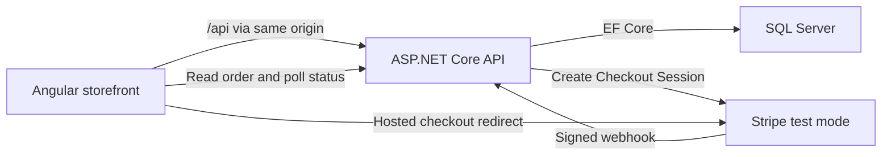
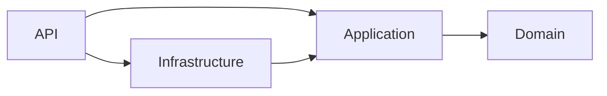

# Circuit Supply | Stripe Payment Application

An Angular 21 storefront and a .NET 10 API for the Saturday utilization task. It covers an INR product catalog, a persistent cart, guest checkout, and a browser-scoped order history. Stripe Checkout hosts payment entry in test mode.

## Projects

| Project | Location | Stack |
| --- | --- | --- |
| Storefront | `stripe-payment-ui` | Angular 21, TypeScript, SCSS, RxJS, NgRx, Vitest |
| API | `StripePayment.Api` | ASP.NET Core 10, EF Core 10, SQL Server, Stripe.net, OpenAPI |
| API tests | `StripePayment.Api.Tests` | xUnit, ASP.NET test host, SQL Server LocalDB, stubbed Stripe HTTP |



## Local setup on Windows

Prerequisites are Node.js 24, npm, .NET SDK 10 and SQL Server LocalDB. Install the [Stripe CLI](https://docs.stripe.com/stripe-cli) for end-to-end payment testing. Use three PowerShell terminals and run the following from the `stripe-task` folder unless a command changes the directory.

Terminal 1, API and SQL Server:

```powershell
sqllocaldb start MSSQLLocalDB
dotnet tool restore
dotnet tool run dotnet-ef database update --project StripePayment.Infrastructure --startup-project StripePayment.Api
dotnet run --project StripePayment.Api --launch-profile http
```

Terminal 2, Angular:

```powershell
Set-Location stripe-payment-ui
npm ci
npm start
```

Open [the storefront](http://localhost:4200/products) and [Swagger UI](http://localhost:5075/swagger). The Angular development proxy maps `/api/**` to port 5075. Restart a running Angular development server after changing the proxy. In another environment, serve the frontend and forward `/api` on the same origin. Set `Store__FrontendUrl` to the storefront origin, `ConnectionStrings__Store` to the SQL Server connection string, and configure persistent ASP.NET Data Protection keys if running multiple instances. LocalDB is the default development connection.

To forward Stripe events, use Terminal 3:

```powershell
stripe login
stripe listen --events checkout.session.completed,checkout.session.async_payment_succeeded,checkout.session.async_payment_failed,checkout.session.expired --forward-to http://localhost:5075/api/webhooks/stripe
```

Stop the API and configure these values from the `stripe-task` folder. Use the test secret key from your Stripe sandbox and the signing secret printed by the active listener.

```powershell
dotnet user-secrets set --project StripePayment.Api 'Stripe:SecretKey' '<your sk_test_ key>'
dotnet user-secrets set --project StripePayment.Api 'Stripe:WebhookSecret' '<your whsec_ signing secret>'
dotnet run --project StripePayment.Api --launch-profile http
```

The equivalent environment variables are `Stripe__SecretKey` and `Stripe__WebhookSecret`. Keep them on the server. Use a Stripe sandbox that supports INR and has cards enabled in its payment methods configuration. The SDK uses the sandbox's available Checkout payment methods.

## Architecture and schema

The backend uses four projects with dependencies pointing toward the domain.

| Layer | Responsibilities |
| --- | --- |
| Domain | Core entities, INR conversion, and payment state transitions |
| Application | Checkout and payment confirmation use cases, persistence and payment ports, and request and response contracts |
| Infrastructure | EF Core persistence and migrations, Stripe Checkout and webhook signature adapters |
| API | HTTP controllers, guest cookies, dependency injection, problem responses, and OpenAPI |



| Table | Role |
| --- | --- |
| Products | Seeded laptop, mobile phone, and headphones with INR decimal prices |
| Orders | Guest ownership, request fingerprint, contact and delivery fields, total, creation date |
| OrderItem | Product ID, quantity, and purchase-time name and price snapshots |
| Payments | Order-to-session association, payment intent, verified payment state, SQL row version |
| ProcessedEvents | Stripe event ID as primary key, plus receipt time |

The API accepts product IDs and quantities, loads prices from SQL Server, and converts exact INR decimals to integer paise. The database enforces a globally unique random checkout request ID. Only the owning guest can reuse that ID. The Stripe request reuses an idempotency key derived from the order ID. An HttpOnly, Data Protection-protected cookie identifies each guest browser. Order reads filter by that identity. A browser return from Stripe, and even a known valid order ID, cannot update a payment or authorize access to another browser's order.

After signature verification, the webhook checks test mode, session ID, currency, and amount. A Checkout success event with `payment_status=paid` confirms payment. Expired and asynchronous failure events update pending payments. A verified paid event can supersede a failure and a late failure cannot undo paid status. EF Core commits the payment update and the event record together. The unique event ID and payment row version handle repeated and concurrent deliveries. If a webhook precedes session persistence, the API returns a retryable response.

## Learning map

| Angular concept | Example |
| --- | --- |
| Components and communication | `ProductList` sends its product to `ProductCard` through an input. The card emits its Add to cart event through an output. |
| Binding, directives, and pipes | Interpolation renders totals, property binding supplies image URLs, events drive cart actions, and `ngModel` binds search. `NgClass` marks premium cards, `appBusy` controls checkout, and built-in currency/date pipes and the custom order reference pipe format output. Templates use `@if`, `@for`, `@empty`, and `@switch`. |
| Lifecycle | `ProductList` logs initialization and destruction. `ProductCard` handles input changes through `ngOnChanges`. |
| Dependency injection | The Angular injector resolves services through `inject()`. `providedIn: 'root'` gives components a shared app-wide instance. Services isolate HTTP, notifications, and cart operations. |
| Router and guard | Lazy routes render in `RouterOutlet`. `RouterLink`, path parameters, and the Stripe return query parameter support navigation. The empty-cart guard is a UX constraint. Order authorization happens on the API. |
| Reactive forms | The non-nullable `FormBuilder` creates a typed group of controls. Built-in validators and the custom PIN validator drive inline errors on touched or dirty fields. |
| HTTP | Typed `HttpClient` responses feed each feature. The interceptor logs method and URL in development and retries transient GET failures. Checkout POST is submitted once per user action. |
| RxJS | Catalog search combines filters with `combineLatest` and debounces and deduplicates queries. The NgRx effect uses `switchMap` to cancel superseded requests and `catchError` to emit failure actions. Order detail uses `forkJoin` for its initial reads, `filter` and `mergeMap` for status updates, and `of` to emit values. The checkout bridges a Web Crypto promise with `from`. The `subscribe` observer receives success or error. |
| Subscription lifetime | HTTP observables are lazy and cancel when unsubscribed. The hashing promise starts when invoked and resolves once. `takeUntilDestroyed()` ties subscriptions to the Angular lifecycle, and `toSignal()` manages view subscription cleanup. |
| Signals and OnPush | The cart owns a writable signal, exposes read-only state, computes totals and quantities, and uses an effect to write to local storage. Template signal reads notify Angular to check the OnPush view when they change. Signals suit current synchronous values. RxJS suits event and request streams that unfold over time. |
| NgRx | Catalog actions drive a reducer and selectors. The asynchronous effect dispatches loading outcomes. Development builds enable Redux DevTools. The catalog is the only feature in NgRx. Cart/UI signals own independent state, and a small application can use services alone if it needs fewer centralized state tools. |

## API

| Method and path | Behavior |
| --- | --- |
| GET `/api/products?query=&category=&sort=` | Filter by name and category, sort by price with `asc` or `desc` |
| GET `/api/products/{id}` | Fetch one product |
| POST `/api/checkout/session` | Accept `requestId`, `customer`, and `items: [{ productId, quantity }]`. Create or resume a pending order and return `{ id, url }`. |
| GET `/api/orders` | List orders belonging to the guest browser |
| GET `/api/orders/{id}` | Read that guest's order and item snapshots |
| GET `/api/orders/{id}/status` | Read verified payment status for that guest |
| POST `/api/webhooks/stripe` | Receive raw Stripe event bytes with `Stripe-Signature` |

## Verification

```powershell
npm --prefix stripe-payment-ui run build
npm --prefix stripe-payment-ui test -- --watch=false
dotnet test StripePayment.Api.slnx
```

The API integration suite uses isolated LocalDB databases and a Stripe HTTP stub. It exercises server pricing, invalid carts, idempotency, guest isolation, signed and invalid webhooks, delayed confirmation, duplicate deliveries, and an out-of-order expiry.

Manual Stripe sandbox scenarios:

| Scenario | Expected behavior |
| --- | --- |
| Successful payment | Add a product and check out with Stripe's `4242 4242 4242 4242` test number, a future expiry and a test CVC. The status moves from Pending to Paid after a valid webhook. |
| Cancellation | Use the return link on hosted Checkout. The cart is still available and the order remains pending. Resubmitting the same checkout details resumes the open session. |
| Declined payment | Use the official generic decline test card `4000 0000 0000 0002`. Stripe allows retry within the session. A declined card attempt does not establish a successful order. |
| Delayed webhook | Stop forwarding before paying, verify the app still shows Pending, then resend the real payment event through a configured snapshot webhook destination. The CLI listener alone does not replay events it missed. Reload the order if the two-minute polling window elapsed. |
| Duplicate webhook | Resend a real matching session event to a configured webhook destination. The stored order status stays consistent. |
| Invalid signature | POST a body without a valid signature while the signing secret is configured. The API returns 400. |
| Duplicate checkout | Submit the same request ID, cart and customer in the same guest session twice. Both responses reference the same order and open session. |

Use only the [official Stripe test payment methods](https://docs.stripe.com/testing). A generic `stripe trigger checkout.session.completed` creates an unrelated fixture, which cannot mark an order created by this app as paid. For the Stripe integration rationale, see [Checkout fulfillment](https://docs.stripe.com/checkout/fulfillment) and [Stripe webhooks](https://docs.stripe.com/webhooks).

## Troubleshooting

- **Catalog error**. Check `/api/products` directly on port 5075, confirm that LocalDB is started and that the EF migration was applied. If the browser gets HTML from `/api/products`, restart Angular to reload the proxy configuration.
- **Checkout returns 503**. Configure a valid `sk_test_` key in the API, then restart it.
- **A paid Checkout is still pending**. Check the listener, the signing secret, and that the event belongs to the same sandbox and Checkout Session. Use the original browser and hostname.
- **Order history is empty**. History is tied to the protected guest cookie in that browser. Use the same browser profile and hostname used for checkout.
- **Starting a checkout after a closed attempt**. A verified terminal order retires its local attempt key. Submit again to begin a new order after reviewing the closed attempt.
- **Database changes**. Generate a new migration from the `stripe-task` folder with `dotnet tool run dotnet-ef migrations add <Name> --project StripePayment.Infrastructure --startup-project StripePayment.Api`, then apply it with `dotnet tool run dotnet-ef database update --project StripePayment.Infrastructure --startup-project StripePayment.Api`.

Catalog photography from [Unsplash](https://unsplash.com/license).
